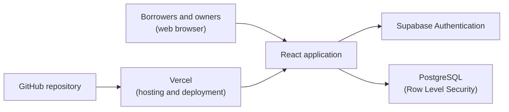

# AccessLoop

**Unlock Underused Equipment and Spaces**  
*Discover. Request. Share. Manage.*

AccessLoop is a resource-sharing platform designed to help institutions and communities discover, request, manage, and share underutilized equipment and spaces through a structured and trusted booking system.

### 🚀 [Open the live application](https://accessloop-three.vercel.app/)

- **Live application:** https://accessloop-three.vercel.app/
- **Source code:** https://github.com/nitinsaigollamudi/accessloop
- **Judge access:** Open self-registration, no credentials from the team needed (see [Judge Quick Start](#judge-quick-start)).
- **Check-in rule:** Check-in works only inside the approved booking window (see [Booking Window and Check-in](#booking-window-and-check-in)).

**Jump to:** [Quick Start](#judge-quick-start) · [Walkthroughs](#resource-owner-walkthrough) · [Booking Window](#booking-window-and-check-in) · [Features](#implemented-features) · [Architecture](#system-architecture) · [Tech Stack](#technology-stack) · [Local Development](#local-development)

---

## AccessLoop at a Glance

AccessLoop manages the whole lifecycle of a shared resource instead of only reserving a time slot:

`List → Discover → Request → Review and approve → Check in → Check out → History`

| Role | What they do in AccessLoop |
|---|---|
| **Resource Owner** | Publishes resources, sets availability and access conditions, reviews borrower eligibility, and approves or rejects booking requests. |
| **Borrower** | Discovers resources, requests bookings with eligibility information, tracks status, checks in and out, and records the resource's condition. |

The owner stays in control of who receives access, and each booking keeps a record of what happened.

---

## Judge Quick Start

> [!NOTE]
> You can evaluate the full product on your own. Registration is open, email verification is disabled, and you can sign in immediately after registering. No team-provided credentials are needed. Please use fictional test information rather than real personal data.

You will use **two accounts**, one per role. To keep both signed in at the same time, use a normal browser window for one and a private/incognito window (or a second browser) for the other.

1. **Open the app:** https://accessloop-three.vercel.app/
2. **Register an owner account** and select the **Resource Owner** role. Create and publish a resource listing with its availability and access conditions.
3. **Register a borrower account** in the second window, with a different email address and the **Borrower** role.
4. **As the borrower:** Find the resource and submit a booking request with the requested eligibility information. Choose a booking window that includes the time you plan to test.
5. **As the owner:** Review the request and the borrower's eligibility information, then **approve** it.
6. **As the borrower:** Check in once the booking window is open and record the initial condition, then check out and record the final condition.

> [!IMPORTANT]
> **Approval does not make check-in available immediately.** Check-in works only during the approved booking window. If check-in is not available right after approval, the window has most likely not started yet. This is the intended behavior, not a malfunction. Details are in [Booking Window and Check-in](#booking-window-and-check-in).

---

## Registration and Role Selection

- Public self-registration is available to everyone.
- You select your role during registration: **Resource Owner** or **Borrower**.
- Email verification is disabled, so no confirmation email is needed and you can sign in straight after registering.
- To experience both sides of the product, create **one account for each role**, using two different email addresses.
- No team-provided demo credentials are required.

---

## Resource Owner Walkthrough

1. Register with the **Resource Owner** role and sign in.
2. Create a resource listing for a space or a piece of equipment.
3. Configure the resource's **availability** and **access conditions**.
4. Publish the listing so borrowers can discover it.
5. View incoming **booking requests**.
6. Review the borrower's **eligibility information**.
7. **Approve or reject** the request.
8. Manage your resources and bookings, and follow their activity, notifications, and any incident reports.

## Borrower Walkthrough

1. Register with the **Borrower** role and sign in (use a separate account from the owner).
2. **Discover** the available resources.
3. Open a resource to view its information and availability.
4. Submit a **booking request** and provide the required **eligibility information**.
5. **Track the booking status** while the owner reviews the request.
6. After approval, **check in during the approved booking window** and record the **initial condition** of the resource.
7. When finished, **check out** and record the **final condition**.
8. Review your booking history and notifications.

---

## Complete End-to-End Evaluation Sequence

Use this table as a checklist to confirm the entire booking lifecycle.

| # | Who | Action | What to confirm |
|---|---|---|---|
| 1 | Owner | Register as a Resource Owner and sign in | The account works immediately, with no email verification. |
| 2 | Owner | Create and publish a resource with availability and access conditions | The listing is saved and can be discovered by borrowers. |
| 3 | Borrower | Register as a Borrower in a second window and sign in | A separate account with the Borrower role. |
| 4 | Borrower | Discover the resource and review its details and availability | The listing, availability, and conditions are visible. |
| 5 | Borrower | Submit a booking request with eligibility information | The request is recorded and its status can be tracked. |
| 6 | Owner | Open the request and review the borrower's eligibility information | The request and the eligibility details are visible to the owner. |
| 7 | Owner | Approve (or reject) the request | The borrower sees the updated booking status. |
| 8 | Borrower | Check in inside the approved booking window and record the initial condition | Check-in succeeds only while the window is open. |
| 9 | Borrower | Check out and record the final condition | The booking is completed with initial and final condition records. |
| 10 | Both | Review booking activity, transaction history, and notifications | The lifecycle is recorded as booking activity. |

**Also worth exploring:** Resource waitlist management, incident reporting and resolution, and notifications and booking reminders. These are implemented features of the live application (see [Implemented Features](#implemented-features)).

---

## Booking Window and Check-in

AccessLoop deliberately separates **approval** from **check-in**:

1. The borrower requests a booking for a specific time window.
2. The owner approves the request.
3. Check-in becomes possible **only while the current time is inside the approved booking window**.

This protects owners: a resource cannot be checked into before or outside the time it was booked for. The time-window rule is validated at the database layer, not only in the interface.

**To test check-in quickly**, request a booking window that includes the time you will be testing, or one that starts a few minutes from now. Once the owner has approved it and the window is open, check in. If you request a window that starts later, check-in correctly stays unavailable until that window begins.

---

## Implemented Features

All features listed below are implemented and working in the live application.

### Accounts and Roles
- Authentication and user profiles through Supabase Authentication.
- Public self-registration with role selection (Resource Owner or Borrower).
- Role-based access for owners and borrowers.

### Resource Management (Owners)
- Create and publish resource listings for spaces and equipment.
- Configure availability and access conditions.
- View booking requests, and manage resources and bookings.

### Discovery and Booking (Borrowers)
- Discover available resources.
- View resource information and availability.
- Submit booking requests with eligibility information.
- Track booking status.

### Eligibility and Approval
- Owner review of borrower eligibility information.
- Owner approval or rejection of booking requests.

### Check-in, Check-out, and Condition Records
- Check-in restricted to the approved booking window.
- Initial condition recording at check-in.
- Check-out with final condition recording.

### Fair Access and Communication
- Resource waitlist management.
- Notifications and booking reminders.

### Accountability
- Incident reporting and resolution.
- Booking activity and transaction history.

### Security
- Database-level access control with Supabase Row Level Security (RLS).

---

## Problem and Proposed Solution

**The problem.** Colleges, laboratories, makerspaces, and community organizations often own rooms, devices, and specialized equipment that sit idle for long periods, while students, researchers, creators, and early-stage teams cannot afford to buy or privately rent comparable resources. Showing an open time slot is not enough. An owner lending institutional property needs to know *who* will use it, whether they are *eligible*, *when* it will be used and returned, and in what *condition*. Without these controls, sharing risks misuse, damage, unauthorized access, and unfair allocation.

**The solution.** AccessLoop combines discovery and scheduling with eligibility review, owner approval, time-aware check-in, and condition records. A resource owner lists an asset with its availability and conditions. A borrower discovers it and requests access. The owner reviews eligibility and decides. An approved borrower checks in during the booked window and records the resource's condition, then checks out and records its final condition. The booking record and related activity history keep the transaction accountable, and the owner keeps authority and human oversight throughout.

**Selected use case.** Sharing institution-owned rooms, equipment, and technical resources within a trusted community, with owner approval before use.

---

## System Architecture



Users open the React application hosted on Vercel. The application talks to Supabase for authentication and application data. PostgreSQL stores resource and booking information, and Row Level Security together with database-side rules controls who can read or change what, including the check-in window.

### Repository Layout (Top Level)

```text
accessloop/
├── public/            # Static assets
├── src/               # Application source code (React)
├── index.html         # Vite entry HTML
├── package.json       # Dependencies and npm scripts
├── package-lock.json
├── vite.config.js     # Vite configuration
├── eslint.config.js   # ESLint configuration
├── .gitignore
└── README.md
```

### npm Scripts (from `package.json`)

| Script | Command | Purpose |
|---|---|---|
| `npm run dev` | `vite` | Start the development server |
| `npm run build` | `vite build` | Create a production build |
| `npm run preview` | `vite preview` | Preview the production build locally |
| `npm run lint` | `eslint .` | Run the linter |

---

## Technology Stack

| Layer | Technology |
|---|---|
| Frontend | React, JavaScript |
| Build tooling | Vite |
| Styling | CSS, Tailwind CSS |
| Routing and icons | React Router, lucide-react |
| Backend and database | Supabase, PostgreSQL |
| Authentication | Supabase Authentication |
| Database security | Row Level Security (RLS) |
| Hosting | Vercel |
| Source control | GitHub |
| Code quality | ESLint |

---

## Trust, Safety, and Access Control

- **Authentication:** Registration and sign-in are handled by Supabase Authentication.
- **Role-based access:** The role (Resource Owner or Borrower) is chosen at registration, and each role has its own responsibilities in the booking lifecycle.
- **Row Level Security:** PostgreSQL RLS policies restrict data access at the database level, so protection does not depend on the interface alone.
- **Owner control:** A booking request needs the owner's review and approval before the borrower can proceed.
- **Human eligibility review:** Eligibility information is reviewed by the resource owner rather than decided automatically.
- **Time-aware check-in:** Check-in is validated against the approved booking window at the database layer.
- **Accountability:** Bookings keep activity and transaction history, initial and final condition records, and incident reports.
- **Fair access:** Owner-controlled approval and resource waitlist management support fair handling of requests.
- **Privacy:** The platform is intended to collect only the information needed to manage access and eligibility. Please use fictional data when testing.
- **Secrets:** The Supabase service-role key must never be placed in frontend code or committed to GitHub. The repository's `.gitignore` excludes `.env` files.

---

## Testing Notes

- The complete owner-to-borrower workflow has been tested successfully by three independent testers.
- Account isolation, resource ownership, and booking permissions have also been tested.
- The latest deployed Vercel version has been tested.

---

## Local Development

> The recommended way to evaluate AccessLoop is the [live application](https://accessloop-three.vercel.app/), which is already configured. Running locally additionally requires your own Supabase project with the application's database schema and security policies set up.

**Prerequisites:** Node.js (a current LTS version is recommended), npm, Git, and a Supabase project.

```bash
# 1. Clone the repository
git clone https://github.com/nitinsaigollamudi/accessloop.git
cd accessloop

# 2. Install dependencies
npm install

# 3. Create a local .env file (see "Environment Setup" below)

# 4. Start the development server
npm run dev

# 5. Create a production build (optional)
npm run build
```

Vite prints the local address in the terminal when the development server starts.

---

## Environment Setup

AccessLoop is a Vite application and reads its Supabase connection settings from a local `.env` file in the project root. You need two values from your own Supabase project: the **project URL** and the **public (anon) API key**. Vite exposes only variables whose names start with `VITE_` to browser code. The exact variable names the app reads are defined where the Supabase client is created in `src/`.

<!-- TODO (maintainers): list the exact environment variable names used by the Supabase client in src/ here. -->

> [!WARNING]
> Never commit `.env` files, private credentials, or the Supabase **service-role** key to GitHub, and never place the service-role key in frontend code.

---

## Future Scope

Possible improvements beyond the current build:

- Before-and-after condition photos as visual evidence.
- Institutional identity verification and training or certification integrations.
- Usage analytics for owners to identify underutilized resources.
- Per-user usage limits and fuller fair-use controls for high-demand resources.
- Enhanced institutional administration tools.
- Further accessibility improvements.
- Support for multiple institutions and campuses.

---

## AI Tools and External Services

- **AI-assisted development:** ChatGPT and Google Gemini/Antigravity were used during implementation and debugging. AI assistance did not replace review and live testing by the team.
- **Open-source libraries:** React, React DOM, React Router, Vite, Tailwind CSS, lucide-react, the Supabase JavaScript client, and ESLint.
- **External services:** Supabase (authentication and PostgreSQL), Vercel (hosting), and GitHub (source control).

---

## Team

| Member | Role | Contribution |
|---|---|---|
| Gollamudi Sai Nitin | Frontend and Backend Execution | Frontend and backend implementation and integration |
| E Sai Abhinay | Documentation and Execution | Project documentation and implementation support |
| M Vivek Kumar | Execution, Testing and Debugging | Implementation support, testing and debugging |
| S Jayaharsha | Execution, Testing and Debugging | Implementation support, testing and debugging |

---

## Project Information

| Field | Details |
|---|---|
| **Project** | AccessLoop: Unlock Underused Equipment and Spaces |
| **Hackathon** | 48-hour build, 30 October to 1 November 2026 |
| **Problem statement** | Unlock Underused Equipment and Spaces |
| **Live application** | https://accessloop-three.vercel.app/ |
| **Repository** | https://github.com/nitinsaigollamudi/accessloop |

**Documentation note:** This README describes the latest tested live deployment. Some features that the project report submitted to the organizers lists as future scope were completed and tested after that report was written, and this README reflects the current build.

AccessLoop aims to make underused institutional resources more accessible without compromising owner control, eligibility checks, or accountability. By structuring the journey from listing and discovery through approval, check-in, and return, it offers colleges and communities a practical foundation for trusted resource sharing.
